# 🌟 Awesome IT Service Desk & ITSM

  

  
  
  
  
  
  

---

## 🎯 Overview & Scope

A curated collection of industry-leading **ITSM (IT Service Management)**, **ITIL Service Desk**, **CMDB (Configuration Management Database)**, and **IT Asset Management (ITAM)** solutions. Designed for CIOs, DevOps teams, sysadmins, and IT support leads evaluating cloud SaaS suites and sovereign open-source platforms.

Whether you need ITIL 4-compliant incident, problem, and change management workflows, automated self-service portals, network discovery, or sovereign on-premises service infrastructure, this guide covers verified enterprise SaaS vendors and actively maintained open-source alternatives.

---

## 📑 Table of Contents

- [📊 Sector Overview & Market Dynamics](#-sector-overview--market-dynamics)
- [☁️ Top SaaS & Cloud Platforms](#️-top-saas--cloud-platforms)
- [💻 Open-Source GitHub Projects](#-open-source-github-projects)
- [🛠️ Complementary Open-Source Ecosystem](#️-complementary-open-source-ecosystem)
- [⭐ Star History](#-star-history)
- [🤝 How to Contribute](#-how-to-contribute)
- [💖 Support](#-support)
- [📜 Disclaimer](#-disclaimer)

---

## 📊 Sector Overview & Market Dynamics

The global IT Service Management (ITSM) software market is estimated at **$13.58 billion in 2024–2025** and is projected to reach **$36.78 billion by 2032**, expanding at a robust compound annual growth rate (CAGR) of **15.3%**.

The market exhibits a **moderately concentrated** structure: the upper enterprise echelon is heavily dominated by a handful of established powerhouses—most notably **ServiceNow**, which captures the largest share of Fortune 500 deployments—alongside enterprise stalwarts like **Atlassian**, **BMC Helix**, and **Ivanti**. Conversely, the mid-market and SMB segments are **highly fragmented and aggressively contested** by agile innovators, product-led platforms (such as Freshworks, Zoho ManageEngine, and HaloITSM), and a surging ecosystem of self-hosted, sovereign open-source alternatives driven by AI-assisted workflows and cost-optimization initiatives.

---

## ☁️ Top SaaS & Cloud Platforms

The table below features the top SaaS ITSM platforms, sorted in descending order by parent company scale (market capitalization or estimated enterprise valuation).

| Platform | Provider / Parent Org | Valuation / Company Scale | Starting Tier Pricing | Free Tier Limits / Evaluation Period | Core ITSM & ITIL Capabilities |
| :--- | :--- | :--- | :--- | :--- | :--- |
| **[ServiceNow ITSM](https://servicenow.com)** | ServiceNow (NYSE: NOW) | ~$160B–$220B Market Cap | $38.00–$100.00 / fulfiller / month (Standard/Foundation tier via annual contract quotes) | **Free Trial Only**: Accessible via guided enterprise sales Proof-of-Concept (PoC) / sandbox; developer instances (PDI) available for personal testing with inactivity reclamation | Enterprise benchmark for ITIL 4 workflows, advanced CMDB, AI virtual agents, predictive intelligence, and cross-department digital orchestration. |
| **[Jira Service Management](https://atlassian.com/software/jira/service-management)** | Atlassian (NASDAQ: TEAM) | ~$43B–$63B Market Cap | $17.65 / agent / month (Standard tier, billed annually) or $22.05 / agent / month (monthly) | **Permanently Free Plan**: Up to **3 agents**, unlimited customer requesters, **2 GB file storage**, and 500 automation runs/month | High-velocity ITSM deeply unifying engineering, IT operations, and support with built-in Assets CMDB, alert aggregation, and agile change approvals. |
| **[Zoho ServiceDesk Plus](https://manageengine.com/products/service-desk/)** | Zoho Corporation (ManageEngine) | ~$12.5B Valuation (Privately held, ~$1.4B+ revenue) | $13.00 / technician / month (Standard Cloud tier) | **Permanently Free Plan**: Up to **5 technicians**, unlimited requesters, permanent full access to Incident Management & Knowledge Base (AMS support optional) | Comprehensive ITSM suite integrating incident, problem, and change workflows with built-in CMDB, asset scanning, and seamless Zoho ecosystem integrations. |
| **[BMC Helix ITSM](https://bmc.com/it-solutions/bmc-helix-itsm.html)** | BMC Software (KKR) | ~$8.5B+ Valuation (~$2.3B+ ARR) | $115.00 / named user / month (Entry standard tier based on enterprise licensing quotes) | **Free Trial Only**: No direct instant self-service trial for Helix core (guided enterprise sales PoC); 30-day free trial offered for Remedyforce on Salesforce AppExchange | Cognitive service management with automated multi-cloud discovery, predictive AIOps, incident correlation, and complex enterprise compliance capabilities. |
| **[Freshservice](https://freshworks.com/freshservice/)** | Freshworks (NASDAQ: FRSH) | ~$3.5B–$4.9B Market Cap | $19.00 / agent / month (Starter tier, billed annually) or $29.00 / agent / month (monthly) | **Free Trial Only**: **14-day free trial** with full platform capabilities, no credit card required | Cloud-native service desk featuring intuitive UI, AI-powered Freddy virtual agent, automated ticket routing, asset lifecycle discovery, and release management. |
| **[SolarWinds Service Desk](https://solarwinds.com/service-desk)** | SolarWinds (Turn/River Capital) | ~$4.4B Enterprise Value (Delisted 2025) | $39.00 / technician / month (Essentials tier, billed annually) | **Free Trial Only**: **30-day fully functional free trial** with access to premier automations and virtual agents | Modern cloud ITSM delivering automated ticket classification, asset inventory tracking, self-service employee portals, and visual configuration mapping. |
| **[HaloITSM](https://haloitsm.com)** | Halo Service Solutions | ~$2.0B Valuation (~$100M ARR, Bootstrapped) | $65.00–$99.00 / agent / month (All-inclusive tier, billed annually) | **Free Trial Only**: **30-day free trial** with 100% full feature and module access, no credit card required | Fast-growing, all-inclusive ITIL service desk offering ticketing, asset management, change controls, calendar scheduling, and native AI assistants without tier-gated features. |
| **[Ivanti Neurons for ITSM](https://ivanti.com/products/ivanti-neurons-itsm)** | Ivanti (Clearlake / TA Associates) | ~$2.0B+ Valuation (~$800M+ ARR) | $25.00–$60.00 / user / month (Estimated entry tiers for base modules via annual contract quotes) | **Free Trial Only**: No public self-service trial; formal sales demo and enterprise pilot available upon request | Automated enterprise service management uniting ITIL workflows with autonomous endpoint healing, zero-trust security integration, and Cherwell-powered workflows. |
| **[TOPdesk](https://topdesk.com)** | TOPdesk (CVC Capital Partners) | ~$600M–$800M Implied Valuation (~$190M ARR) | $76.00 / agent / month (Essential tier, billed annually) | **Free Trial Only**: **30-day fully functional free trial** covering both the Operator management desk and Self-Service portal | European market-leading Enterprise Service Management (ESM) platform combining IT service desk, Facilities Management, and modular CMDB workflows. |
| **[SysAid](https://sysaid.com)** | SysAid Technologies (IGP) | ~$200M–$300M Implied Valuation (~$35M ARR) | $89.00 / agent / month (Professional AI tier, billed annually) | **Free Trial Only**: **14-day free trial** with full AI Copilot and service desk capabilities, no credit card required | AI-first IT service management suite providing automated ticket categorization, asset discovery, integrated remote control tools, and self-healing task execution. |

---

## 💻 Open-Source GitHub Projects

The following self-hosted and open-source ITSM platforms, ticketing suites, and CMDBs are sorted in descending order by GitHub stargazers count.

| Project | Stars | Primary Focus | Description |
| :--- | :--- | :--- | :--- |
| **[RustDesk](https://github.com/rustdesk/rustdesk)** |  | Remote Support / Desktop | Sovereign self-hosted remote desktop software enabling service desk agents to troubleshoot client endpoints securely without third-party SaaS dependencies. |
| **[Chatwoot](https://github.com/chatwoot/chatwoot)** |  | Omnichannel Help Desk | Modern open-source customer and IT support platform featuring live chat widgets, shared email inbox management, multi-channel queuing, and integrations. |
| **[Docmost](https://github.com/docmost/docmost)** |  | IT Knowledge Base & Wiki | Modern open-source collaborative wiki and documentation platform serving as a fast, real-time knowledge base and runbook engine for IT teams. |
| **[NetBox](https://github.com/netbox-community/netbox)** |  | DCIM / Network CMDB | The leading open-source source of truth for network infrastructure, IPAM, and data center assets, widely utilized as an authoritative infrastructure CMDB. |
| **[UVdesk Community](https://github.com/uvdesk/community-skeleton)** |  | IT Helpdesk & Ticketing | Modular PHP/Symfony open-source ticketing system supporting mailbox synchronization, configurable workflow automation, and customer support portals. |
| **[BookStack](https://github.com/BookStackApp/BookStack)** |  | SOPs & Documentation | Simple, intuitive open-source wiki organized around books, chapters, and pages—extensively deployed alongside service desks for IT SOPs and user guides. |
| **[Snipe-IT](https://github.com/grokability/snipe-it)** |  | IT Asset Management (ITAM) | Industry-standard open-source IT asset management system designed for tracking hardware lifecycles, software licenses, check-outs, accessories, and maintenance logs. |
| **[MeshCentral](https://github.com/Ylianst/MeshCentral)** |  | Remote Endpoint Management | Comprehensive web-based remote monitoring and endpoint management application providing remote desktop, terminal access, and file transfer capabilities. |
| **[GLPI](https://github.com/glpi-project/glpi)** |  | Full ITIL ITSM & ITAM | Leading open-source enterprise service desk featuring native CMDB, incident/problem/change tracking, financial asset management, contract tracking, and SLAs. |
| **[Zammad](https://github.com/zammad/zammad)** |  | Web Helpdesk & Support | Modern web-based ticketing system equipped with real-time multi-agent collaboration, full-text Elasticsearch search, and multi-channel communication channels. |
| **[FreeScout](https://github.com/freescout-help-desk/freescout)** |  | Shared Mailbox & Helpdesk | Lightweight, self-hosted PHP/Laravel help desk and shared mailbox (Help Scout alternative) extensible through modules for LDAP, SLA timers, and internal notes. |
| **[osTicket](https://github.com/osTicket/osTicket)** |  | Support Ticketing System | Time-tested, lightweight open-source ticketing tool reliably capturing and routing user inquiries submitted via email, custom web forms, and REST APIs. |
| **[Peppermint](https://github.com/Peppermint-Lab/peppermint)** |  | Modern Helpdesk Desk | Clean, fast open-source ticket management solution built with Node.js, React, and PostgreSQL for small-to-medium IT support teams. |
| **[Ralph](https://github.com/allegro/ralph)** |  | DCIM & Enterprise CMDB | Asset management, DCIM, and CMDB system engineered by Allegro for tracking data center racks, server hardware lifecycles, and back-office equipment. |
| **[Helpy](https://github.com/helpyio/helpy)** |  | Customer & IT Support | Ruby on Rails-based open-source help desk providing seamless multi-channel ticketing, community discussion forums, and self-service documentation. |
| **[Trudesk](https://github.com/polonel/trudesk)** |  | Help Desk & Bug Tracking | Open-source helpdesk platform built with Node.js and MongoDB featuring real-time ticket updates, task assignments, and internal messaging. |
| **[Faveo Helpdesk](https://github.com/faveosuite/faveo-helpdesk)** |  | Web Ticketing Portal | Laravel-powered open-source helpdesk ticketing system featuring SLA prioritization, pre-written canned responses, and knowledge base portals. |
| **[iTop](https://github.com/Combodo/iTop)** |  | ITIL Service Desk & CMDB | Configurable open-source web application designed by Combodo to manage ITIL service catalogs, configuration items, dependencies, and change requests. |
| **[Request Tracker (RT)](https://github.com/bestpractical/rt)** |  | Enterprise Issue Tracking | Battle-hardened Perl-based ticketing engine developed by Best Practical, renowned for fine-grained access controls, automated email parsing, and custom lifecycles. |
| **[Znuny](https://github.com/znuny/Znuny)** |  | Enterprise Service Desk | Community fork of OTRS engineered for high-volume IT support desks, queue automation, customer communication histories, and SLA enforcement. |
| **[GLPI Agent](https://github.com/glpi-project/glpi-agent)** |  | Automated Discovery Agent | Multi-platform discovery and inventory agent collecting hardware configurations, software packages, and SNMP network switches into GLPI CMDBs. |
| **[OTOBO](https://github.com/RotherOSS/otobo)** |  | ITIL Service Management | Modern OTRS fork providing Docker deployment recipes, a responsive customer portal, and extensions for ITIL configuration management. |

---

## 🛠️ Complementary Open-Source Ecosystem

Extend your sovereign IT Service Desk and ITSM stack with these community-favorite companion tools:

- 📊 **Metrics & SLA Analytics**:
  - **[Grafana](https://github.com/grafana/grafana)**  — Create real-time operational dashboards for ticket volume, MTTR, and SLA breaches.
  - **[Metabase](https://github.com/metabase/metabase)**  — Connect directly to your ticketing database to build ad-hoc business intelligence reports.
- 🔐 **Identity & Directory Access (SSO/LDAP)**:
  - **[Keycloak](https://github.com/keycloak/keycloak)**  — Enterprise OpenID Connect and SAML 2.0 identity federation for service desks.
  - **[Authentik](https://github.com/go-authentik/authentik)**  — Modern, flexible identity provider for self-service user enrollment and SSO.
  - **[LLDAP](https://github.com/lldap/lldap)**  — Lightweight, fast LDAP implementation tailored for user directory synchronization.
- ⚡ **ITIL Change & Runbook Automation**:
  - **[Semaphore UI](https://github.com/semaphoreui/semaphore)**  — Modern web UI for Ansible, Terraform, and PowerShell scripts to automate change tasks.
  - **[Rundeck](https://github.com/rundeck/rundeck)**  — Self-service operations management enabling helpdesk staff to trigger approved remediations.
- 🌐 **Developer Portals & Service Catalogs**:
  - **[Backstage](https://github.com/backstage/backstage)**  — Open framework built by Spotify for centralizing internal service catalogs and infrastructure templates.
- 💬 **Support Collaboration & ChatOps**:
  - **[Mattermost](https://github.com/mattermost/mattermost)**  — High-trust open-source collaboration platform for major incident war rooms and dispatching alerts.

---

## ⭐ Star History

---

## 🤝 How to Contribute

Contributions are warmly encouraged! To propose a new SaaS platform, open-source project, or update existing details:

1. 🍴 Fork the repository.
2. 🌿 Create a new feature branch (`git checkout -b feature/add-new-tool`).
3. 📝 Add your entry ensuring:
   - Factual pricing with specific starting tiers and explicit free-tier/trial limits for SaaS entries.
   - Verified GitHub repository links with stargazer badges for open-source entries.
   - Alphabetical or star-sorted ordering where applicable.
4. 🚀 Submit a Pull Request with a brief summary of the proposed addition.

---

## 💖 Support

If you find this curated collection helpful for designing or benchmarking your IT service desk, please consider supporting the project:

- ⭐ **Star** this repository on GitHub.
- 🍴 **Fork** and share it with fellow sysadmins, DevOps engineers, and IT leaders.
- ☕ **Buy a coffee & sponsor ongoing curation**: Support via the [GitHub Sponsor Dashboard](https://github.com/sponsors/ishandutta2007).

---

## 📜 Disclaimer

- This repository is a community-curated directory intended for research, evaluation, and educational purposes. Mention of commercial products or open-source software does not constitute formal endorsement.
- ITSM platforms handle critical IT infrastructure access, user permissions, and confidential asset inventories. Always enforce multi-factor authentication (MFA), role-based access control (RBAC), and TLS encryption when deploying service desk infrastructure.
